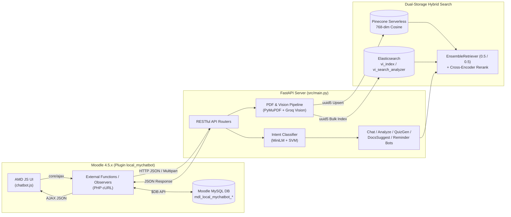

# Moodle Virtual Assistant Backend

Backend RESTful API xây dựng trên nền tảng **FastAPI**, đảm nhận xử lý các tác vụ AI/Machine Learning, RAG (Retrieval-Augmented Generation), Hybrid Search và phân tích dữ liệu học tập cho plugin trợ lý ảo **`local_mychatbot`** trên **Moodle 4.5.x (Moodle 405)**.

---

## Mục lục

- [Kiến trúc & Luồng phối hợp với Moodle](#kiến-trúc--luồng-phối-hợp-với-moodle)
- [Dual-Storage Hybrid Search (Pinecone + Elasticsearch)](#dual-storage-hybrid-search-pinecone--elasticsearch)
- [Các module AI & Chức năng chính](#các-module-ai--chức-năng-chính)
- [Danh sách API Endpoints](#danh-sách-api-endpoints)
- [Cấu trúc thư mục](#cấu-trúc-thư-mục)
- [Cài đặt & Khởi chạy](#cài-đặt--khởi-chạy)
- [Ghi chú tích hợp Moodle (`mychatbot/`)](#ghi-chú-tích-hợp-moodle-mychatbot)

---

## Kiến trúc & Luồng phối hợp với Moodle

Hệ thống vận hành theo mô hình tách biệt giữa Moodle LMS (Client/Plugin) và FastAPI Server (AI/ML Engine), giao tiếp qua HTTP REST (JSON và `multipart/form-data`):

1. **Luồng yêu cầu (Request)**: Người dùng tương tác trên giao diện AMD JavaScript (`mychatbot/amd/src/chatbot.js`) -> gọi `core/ajax` tới Moodle External Function (`mychatbot/classes/external/*.php`) hoặc kích hoạt Event Observer (`mychatbot/classes/event/observer/*.php`) -> Moodle PHP truy vấn CSDL cục bộ và chuyển tiếp HTTP Request (`cURL`) tới địa chỉ `local_mychatbot/fastapi_url` của FastAPI Server.
2. **Luồng phản hồi (Response)**: FastAPI xử lý logic AI/ML/Vector DB -> trả về JSON -> Moodle lưu lịch sử/nhật ký vào các bảng `mdl_local_mychatbot_*` và phản hồi lại cho AMD JS hiển thị lên giao diện chat, biểu đồ tiến độ, thẻ nhắc nhở hoặc bản xem trước câu hỏi Quiz.



### Luồng Text-to-SQL đa bước (`chat_bot/query_bot`)
Khi người dùng hỏi thông tin cá nhân/học vụ trong Moodle (nhãn Intent `2`), quy trình phối hợp diễn ra qua 2–3 vòng gọi API:
1. Moodle (`send_message.php`) gửi câu hỏi tới `POST /chat` -> FastAPI trả về câu lệnh `SELECT` với cú pháp bảng `{table}` của Moodle (`{"type": "sql_response", "sql_query": "..."}`).
2. Moodle thực thi trực tiếp `$DB->get_records_sql($sql_code)` trên CSDL Moodle. Nếu gặp lỗi SQL, Moodle gửi kèm lỗi tới `POST /fix_sql` để AI tự sửa (tối đa 2 lần thử).
3. Sau khi có dữ liệu, Moodle gửi `sql_result` tới `POST /get_sql_answer` để FastAPI tổng hợp câu trả lời tiếng Việt thân thiện ở dạng HTML.

---

## Dual-Storage Hybrid Search (Pinecone + Elasticsearch)

Thay vì phụ thuộc vào một cơ sở dữ liệu duy nhất, module `src/modules/vector_database/vector_db.py` (`VectorDatabase`) áp dụng chiến lược **lưu trữ kép đồng bộ** trên cùng chỉ mục **`moodle-files`** với ID chunk tất định (`uuid5`) để phục vụ tìm kiếm lai (Hybrid Search):

1. **Không gian Vector — Pinecone (Semantic Search)**:
   - Tự động kiểm tra và khởi tạo index serverless **`moodle-files`** (`cloud="aws"`, `region="us-east-1"`, `dimension=768`, `metric="cosine"`) nếu chưa tồn tại trên Pinecone.
   - Mã hóa nội dung tài liệu thành vector chuẩn hóa 768 chiều bằng mô hình đa ngôn ngữ `sentence-transformers/paraphrase-multilingual-mpnet-base-v2`.
2. **Không gian Từ vựng — Elasticsearch (Keyword/Lexical Search)**:
   - Can thiệp sâu vào `settings` và `mappings` khi khởi tạo index `"moodle-files"` thay vì dùng cấu hình mặc định:
     - **`vi_index_analyzer`**: Dùng `tokenizer: "vi_tokenizer"` kết hợp filter `lowercase` để tách từ ghép tiếng Việt chính xác khi lập chỉ mục.
     - **`vi_search_analyzer`**: Dùng `tokenizer: "vi_tokenizer"` kết hợp `lowercase` và `my_synonym_graph` (`synonym_graph`, `expand: True`) nạp từ danh sách từ đồng nghĩa chuyên ngành Anh–Việt trong `src/modules/vector_database/synonyms.py`.
     - **Custom `ElasticsearchBM25Retriever`**: Truy vấn `bool` với `must.match` trên trường `text`, hỗ trợ lọc cứng (`strict_filter=True`) hoặc `should.match_phrase` trên `metadata.course_name` (`boost: 2.0`) để ưu tiên tài liệu đúng môn học, tự động cô lập lỗi nếu index chưa tồn tại.
   - *Lưu ý*: Node **Elasticsearch 9.3.0** cần cài đặt plugin `elasticsearch-analysis-vietnamese-9.3.0` (`duydo`) cung cấp tokenizer `vi_tokenizer` (nếu Elasticsearch không khả dụng hoặc chưa có index, hệ thống vẫn tiếp tục trả về kết quả từ Pinecone).
3. **Hợp nhất & Xếp hạng lại (Fusion & Reranking)**:
   - Kết hợp ứng viên từ Pinecone và Elasticsearch qua `EnsembleRetriever` (`weights=[0.5, 0.5]`), sau đó khử trùng lặp theo nội dung.
   - Mở rộng truy vấn theo từ đồng nghĩa dạng round-robin (`_expand_query_with_synonyms`, giới hạn `max_expansion=4` để tránh nghẽn CPU).
   - Chấm điểm lại từng cặp `(query_variant, document)` bằng `CrossEncoder("cross-encoder/mmarco-mMiniLMv2-L12-H384-v1", activation_fn=nn.Sigmoid())` trên worker thread (`asyncio.to_thread`), lấy điểm **Max-Pooling**, cộng điểm thưởng môn học (`+0.15`, tối đa `1.0` khi `strict_filter=False`) và lọc theo ngưỡng `threshold`.

---

## Các module AI & Chức năng chính

| Module (`src/modules/`) | Công nghệ / Thuật toán | Vai trò chính |
| :--- | :--- | :--- |
| `intent_classifier` | `all-MiniLM-L6-v2` + `StandardScaler` + `SVC` | Phân loại tin nhắn `/chat` thành 3 luồng: `1` (RAG), `2` (Query SQL), `3` (Talk). Dùng ngưỡng tự tin `0.75` (fallback an toàn về RAG). |
| `chat_bot/rag_bot` | `QueryRefiner` (VI↔EN), Hybrid Search, Groq LLM, Tavily / DDGS | Tinh chỉnh & dịch song ngữ câu hỏi, tìm kiếm song song, chọn lọc tài liệu bằng JSON schema, fallback tìm kiếm Web 2 tầng bất đồng bộ (`AsyncTavilyClient` + `DDGS`/`httpx`/`lxml`), trả về HTML + nguồn trích dẫn. |
| `chat_bot/query_bot` | Groq LLM, Moodle `{table}` schema | Sinh MySQL `SELECT`, tự sửa lỗi SQL, kiểm soát bảo mật bắt buộc lọc `user_id` với quyền `student`, diễn giải kết quả thành HTML. |
| `chat_bot/talk_bot` | Groq LLM | Giao tiếp tự nhiên và giới thiệu tính năng hệ thống. |
| `file_processor` & `vision_processor` | PyMuPDF (`pymupdf`), Pillow, Groq Vision | Làm sạch header/footer lặp, tách bảng thành Markdown không lặp chữ, bỏ qua trang mục lục/rác, chuẩn hóa Unicode `NFC`, phân tích sơ đồ/biểu đồ (render 2x PNG, bỏ qua ảnh trang trí qua cờ `SKIP_IMAGE`). |
| `analyze_bot` | Groq LLM, Pydantic `computed_field` | Nhận xét tiến độ tổng thể lớp học và phân tích cá nhân hóa theo học viên (tự phân loại môn Lý thuyết và Thực hành/Thí nghiệm). |
| `docs_suggest_bot` | Hybrid Search (`threshold=0.85`), Groq LLM | Đối chiếu câu hỏi/đáp án quiz với giáo trình để đề xuất tài liệu ôn tập cho quiz mới hoặc quiz điểm thấp (`lowscore`). |
| `quiz_gen_bot` | `asyncio.gather`, Bloom's Taxonomy, JSON Mode | Sinh câu hỏi trắc nghiệm 4 lựa chọn song song theo 3 mức độ nhận thức (`Remember`, `Understand`, `Apply`) từ chủ đề và/hoặc file PDF tải lên. |
| `reminder_bot` | Multi-Armed Bandit (**Thompson Sampling**), Heuristic Scheduling | Sắp xếp độ ưu tiên Assignment; chọn chiến lược nhắc nhở Quiz tối ưu theo thói quen học viên (`Beta(alpha, beta)` qua 5 arms) và đề xuất khung giờ học hợp lý (08:00–22:00). |

---

## Danh sách API Endpoints

| Method | Endpoint | Mô tả | Caller phía Moodle (`mychatbot/`) |
| :--- | :--- | :--- | :--- |
| `GET` | `/status` | Kiểm tra trạng thái hoạt động của FastAPI server | `external/check_status.php` |
| `POST` | `/chat` | Tiếp nhận tin nhắn chat, phân loại Intent và định tuyến RAG / SQL / Talk | `external/send_message.php` |
| `POST` | `/fix_sql` | Sửa câu lệnh SQL dựa trên mã SQL lỗi và thông báo lỗi từ Moodle DB | `external/send_message.php` |
| `POST` | `/get_sql_answer` | Chuyển đổi dữ liệu `sql_result` thành câu trả lời HTML tiếng Việt | `external/send_message.php` |
| `POST` | `/ingest/file` | Tiếp nhận file (`multipart/form-data`) và xử lý lập chỉ mục nền (`BackgroundTasks`) | `event/observer/course_module_created.php`, `course_module_updated.php` |
| `POST` | `/analyze/course` | Phân tích thống kê điểm số và nhóm học viên trong khóa học | `external/analyze_course_progress.php` |
| `POST` | `/analyze/student` | Phân tích chi tiết kết quả Quiz/Assignment của một học viên | `external/analyze_student_progress.php` |
| `POST` | `/docs_suggest` | Gợi ý tài liệu cần ôn tập cho danh sách Quiz | `external/get_doc_needed_for_quiz.php` |
| `POST` | `/generate_quiz` | Sinh bộ câu hỏi trắc nghiệm theo mức độ dễ/trung bình/khó | `external/generate_quiz.php` |
| `POST` | `/reminder/assignment` | Tạo nhắc nhở và phân loại mức độ ưu tiên các bài Assignment sắp hết hạn | `external/get_assignment_reminder_history.php` |
| `POST` | `/reminder/quiz` | Xếp hạng ưu tiên Quiz (Thompson Sampling) và gợi ý khung giờ làm bài | `external/get_quiz_reminder_history.php`, `event/observer/attempt_submitted.php` |

---

## Cấu trúc thư mục

```text
Moodle_VirtualAssistant_BE/
├── src/
│   ├── main.py                      # Khởi tạo FastAPI app, CORS, AppException handler & đăng ký routers
│   ├── core/
│   │   ├── config.py                # Quản lý biến môi trường qua Pydantic BaseSettings (.env)
│   │   └── exception.py             # Định nghĩa AppException, InternalServerError, NotFoundError
│   └── modules/
│       ├── analyze_bot/             # Phân tích tiến độ khóa học & học viên
│       ├── chat_bot/                # Điều phối chat (rag_bot, query_bot, talk_bot)
│       ├── docs_suggest_bot/        # Đề xuất tài liệu ôn tập cho quiz
│       ├── file_processor/          # Trích xuất PDF, bảng Markdown & lọc trang rác (PyMuPDF)
│       ├── file_upload/             # Endpoint /ingest/file chạy BackgroundTasks
│       ├── intent_classifier/       # Dataset, model SVM đã train (.pkl) & script đánh giá
│       ├── quiz_gen_bot/            # Sinh câu hỏi trắc nghiệm theo thang Bloom
│       ├── reminder_bot/            # Nhắc nhở Assignment/Quiz (Thompson Sampling + Scheduling)
│       ├── status_check/            # Health check /status
│       ├── vector_database/         # Hybrid Search (Pinecone + Elasticsearch + CrossEncoder + synonyms)
│       └── vision_processor/        # Phân tích hình ảnh/sơ đồ trên slide/giáo trình qua Groq Vision
├── mychatbot/                       # Bản sao tham chiếu plugin Moodle 4.5.x (local_mychatbot)
├── Dockerfile
├── requirements.txt
└── README.md
```

---

## Cài đặt & Khởi chạy

### 1. Yêu cầu môi trường
- **Python 3.12**
- **Elasticsearch 9.3.0** đang chạy và đã cài đặt plugin `elasticsearch-analysis-vietnamese-9.3.0` (`duydo`) cung cấp tokenizer `vi_tokenizer`
- Tài khoản **Pinecone** (API Key) và **Groq** (API Key)

### 2. Cấu hình biến môi trường
Tạo file `.env` ở thư mục gốc của dự án (tham khảo cấu hình trong `src/core/config.py`):

```env
PINECONE_API_KEY=your_pinecone_api_key
GROQ_API_KEY=your_groq_api_key
ES_URL=http://localhost:9200
PROJECT_NAME=virtual_assistant
# Tùy chọn (nếu để trống hệ thống sẽ tự fallback sang DDGS + httpx/lxml)
TAVILY_API_KEY=your_tavily_api_key
```

> Lưu ý: Không đưa API key thật vào lịch sử Git khi triển khai thực tế.

### 3. Chạy trực tiếp bằng Python (Local)

Luôn chạy lệnh từ **thư mục gốc của repository** để các đường dẫn tương đối của model (như `src/modules/intent_classifier/model_storage/intent_classifier.pkl`) được nạp chính xác:

```bash
python -m venv .venv
# Windows PowerShell:
.\.venv\Scripts\Activate.ps1
# Linux / macOS:
# source .venv/bin/activate

pip install --upgrade pip
pip install -r requirements.txt

uvicorn src.main:app --host 0.0.0.0 --port 8000 --reload
```

Sau khi khởi động thành công, truy cập tài liệu OpenAPI tương tác tại: `http://127.0.0.1:8000/docs`.

> **Lưu ý khi khởi động**: Quá trình import `src.main` sẽ khởi tạo singleton `VectorDatabaseSingleton` và `IntentClassifierSingleton` (tải mô hình HuggingFace embedding, Cross-Encoder reranker, MiniLM và kiểm tra kết nối Pinecone/Elasticsearch), nên lần khởi chạy đầu tiên sẽ cần thời gian tải model.

### 4. Chạy bằng Docker

```bash
docker build -t moodle-va-backend .
docker run -d --name moodle-va-backend -p 8000:8000 --env-file .env moodle-va-backend
```

*(Nếu Elasticsearch chạy trên máy host ngoài container, cấu hình `ES_URL=http://host.docker.internal:9200` trong file env của container).*

### 5. Huấn luyện lại & Đánh giá Intent Classifier (tùy chọn)

Khi cập nhật dữ liệu trong `src/modules/intent_classifier/data/intent_dataset.json`:

```bash
# Huấn luyện và ghi đè file intent_classifier.pkl (chạy từ thư mục gốc)
python -c "from src.modules.intent_classifier.main import IntentClassifier; IntentClassifier().train()"

# Chạy báo cáo đánh giá Precision/Recall/F1 & Confusion Matrix
cd src/modules/intent_classifier
python evaluate_model.py
```

---

## Ghi chú tích hợp Moodle (`mychatbot/`)

- Thư mục `mychatbot/` trong repository là **bản sao tham chiếu** của local plugin `local_mychatbot` cài trên Moodle 4.5.x, dùng để đối chiếu cấu trúc bảng XMLDB (`mychatbot/db/install.xml`), External Functions (`mychatbot/db/services.php`), Event Observers (`mychatbot/db/events.php`) và giao diện AMD (`mychatbot/amd/src/chatbot.js`).
- Trong cài đặt plugin Moodle (`mychatbot/settings.php`), địa chỉ mặc định của backend là `http://127.0.0.1:8000`.
- Lưu ý hiện trạng pipeline nạp tài liệu: Event Observer phía Moodle bắt các file `.pdf`, `.docx`, `.txt`, tuy nhiên `FileProcessService.process_file` ở backend hiện mới hỗ trợ trích xuất định dạng `application/pdf`.
